<div align="center">


<br>


[](https://www.linkedin.com/in/karibwende-blair-088012287)

**[Summary](#summary)** &nbsp;•&nbsp; **[At a glance](#glance)** &nbsp;•&nbsp; **[Design](#design)** &nbsp;•&nbsp; **[Build](#build)** &nbsp;•&nbsp; **[Verify](#verify)** &nbsp;•&nbsp; **[Problems](#problems)** &nbsp;•&nbsp; **[Security](#security)** &nbsp;•&nbsp; **[Commands](#commands)** &nbsp;•&nbsp; **[Next steps](#next)**

</div>

<br>

<h2><a name="summary"></a>Summary</h2>

I built a self-contained virtual lab where a Kali Linux machine sits on its own private network inside VirtualBox. It gives me a safe, repeatable place to practise reconnaissance, scanning, and other security techniques without touching my real network or anyone else's systems.

<table align="center">
  <tr>
    <td align="center" width="25%"><h3>🔒</h3><b>Isolated</b><br><sub>Private NAT Network, unreachable from my physical LAN</sub></td>
    <td align="center" width="25%"><h3>🌐</h3><b>Connected</b><br><sub>Outbound internet for updates and tool downloads</sub></td>
    <td align="center" width="25%"><h3>📌</h3><b>Predictable</b><br><sub>Static IP, fixed gateway, known DNS</sub></td>
    <td align="center" width="25%"><h3>✅</h3><b>Verified</b><br><sub>Tested layer by layer, from address to DNS</sub></td>
  </tr>
</table>

<p align="center">
  
  
  
  
  
</p>

> [!WARNING]
> This lab is for education only. Only test systems you own or have explicit written permission to test.

<br>

<h2><a name="glance"></a>Lab at a glance</h2>

<p align="center">
  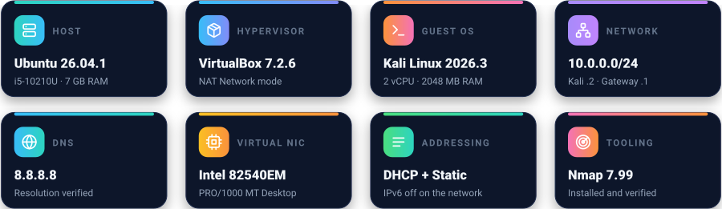
</p>

<br>

<h2><a name="design"></a>Design decisions</h2>

<p align="center">
  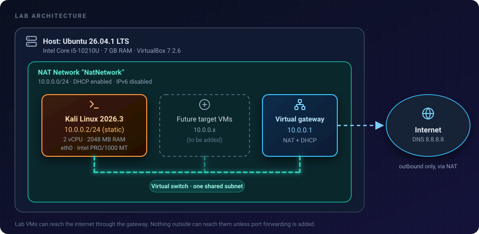
</p>

<table>
  <tr>
    <td width="50%" valign="top">
      <h4>📦 Pre-built Kali image</h4>
      The official VirtualBox image is already installed and configured, so the lab is quick to rebuild and easy to reproduce. The trade-off: I skipped the OS installation, so this project covers networking and lab design rather than installing Linux.
    </td>
    <td width="50%" valign="top">
      <h4>🔗 NAT Network</h4>
      VMs on the same NAT Network can talk to each other and still reach the internet, while staying hidden from my real LAN. That is exactly what a multi-machine attack-and-defence lab needs.
    </td>
  </tr>
  <tr>
    <td width="50%" valign="top">
      <h4>📌 Static IP</h4>
      DHCP gave Kali <code>10.0.0.4</code> on first boot and worked fine, but a fixed address keeps scan results, notes, and future target configs pointing at a machine that never moves.
    </td>
    <td width="50%" valign="top">
      <h4>🏠 Private address range</h4>
      <code>10.0.0.0/24</code> sits in reserved private (RFC 1918) space, so lab traffic can never collide with a routable internet address.
    </td>
  </tr>
</table>

**Why NAT Network and not another VirtualBox mode?** The mode decides who can talk to whom, so it is the most important choice in the lab.

| Mode | VMs reach each other | VMs reach the internet | Exposed to my real LAN | Fit for this lab |
| --- | :---: | :---: | :---: | --- |
| NAT | ❌ | ✅ | ❌ | Too isolated for multi-VM work |
| **NAT Network** | ✅ | ✅ | ❌ | ⭐ **Chosen** |
| Host-only | ✅ | ❌ | ❌ | No updates or downloads |
| Bridged | ✅ | ✅ | ⚠️ **Yes** | Unsafe for vulnerable targets |

<br>

<h2><a name="build"></a>Build walkthrough</h2>

### ① Create the NAT Network

In VirtualBox: **File → Tools → Network Manager → NAT Networks → Create**.

| Setting | Value |
| --- | --- |
| Name | `NatNetwork` |
| IPv4 prefix | `10.0.0.0/24` |
| DHCP | Enabled |
| IPv6 | Disabled |

<p align="center">
  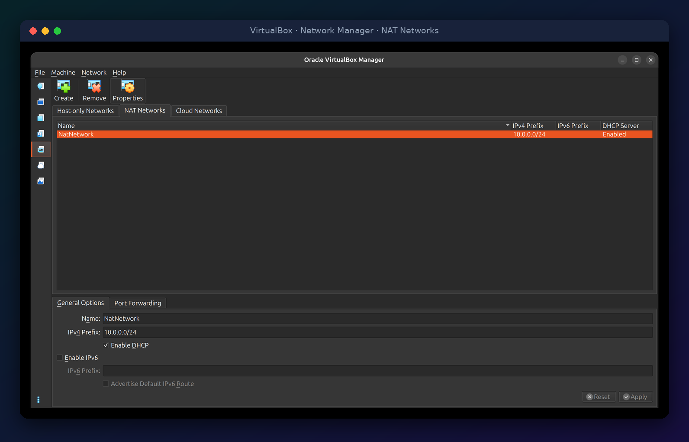<br>
  <sub><b>Figure 1.</b> NAT Network configuration in VirtualBox Network Manager.</sub>
</p>

### ② Import Kali and attach it to the network

I downloaded the pre-built VirtualBox image of Kali from the [official download page](https://www.kali.org/get-kali/) and imported it into VirtualBox. Under **Settings → Network → Adapter 1**, I attached it to the NAT Network.

<p align="center">
  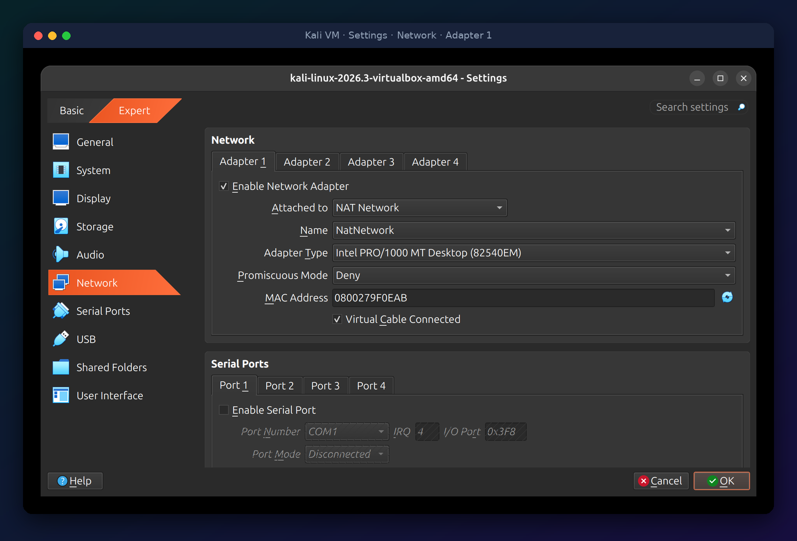<br>
  <sub><b>Figure 2.</b> Adapter 1 attached to <code>NatNetwork</code>, virtual cable connected.</sub>
</p>

I also confirmed the settings from the host with `VBoxManage showvminfo`: 2048 MB RAM, 2 CPUs, and NIC 1 attached to the NAT Network `NatNetwork` with the cable connected and promiscuous policy `deny`.

### ③ Boot Kali and check what DHCP provides

Once Kali was correctly attached to `NatNetwork`, DHCP assigned it `10.0.0.4/24` with a default route via `10.0.0.1`. This proved the lab network worked before I changed anything.

<p align="center">
  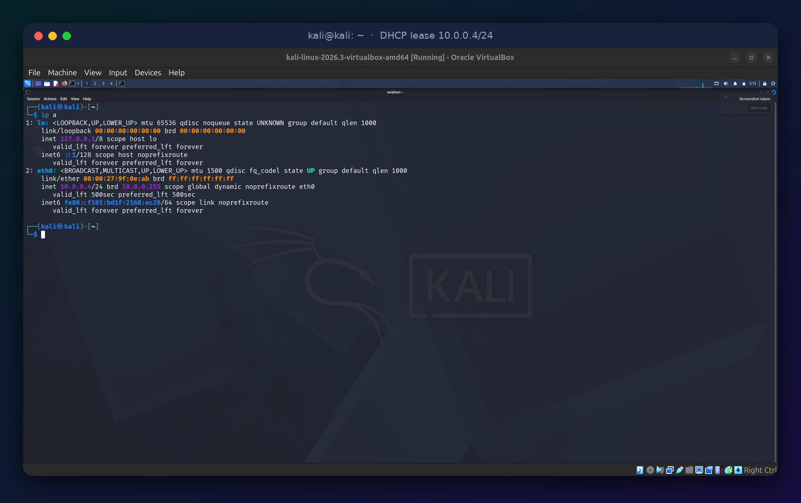<br>
  <sub><b>Figure 3.</b> Dynamic address handed out by the NAT Network's DHCP server.</sub>
</p>

### ④ Set a static IP

I found the connection name with `nmcli connection show` (`Wired connection 1`) and applied:

```bash
sudo nmcli connection modify "Wired connection 1" \
  ipv4.method manual \
  ipv4.addresses 10.0.0.2/24 \
  ipv4.gateway 10.0.0.1 \
  ipv4.dns 8.8.8.8
```

This needed one extra setting before it worked. See [Problem 2](#problem-2). The final state:

<p align="center">
  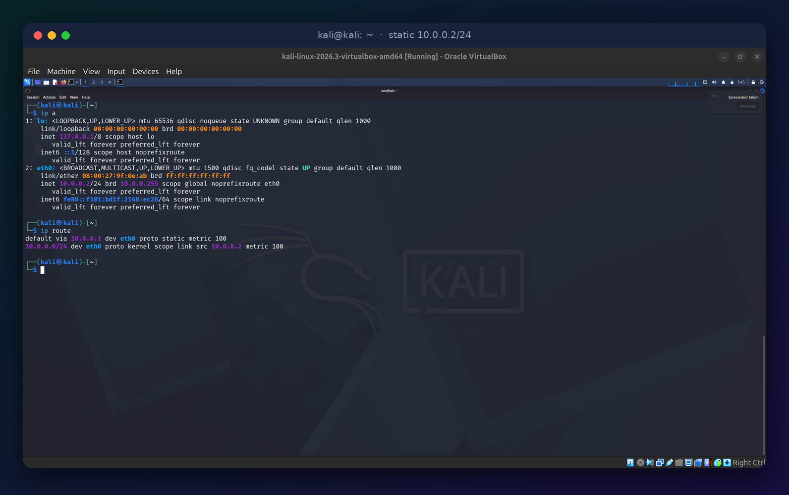<br>
  <sub><b>Figure 4.</b> <code>10.0.0.2/24</code> on <code>eth0</code> with a static default route via <code>10.0.0.1</code>.</sub>
</p>

<br>

<h2><a name="verify"></a>Verification</h2>

I tested the network from the bottom up. Each test depends on the one before it, so a failure points to exactly which layer is broken.

<p align="center">
  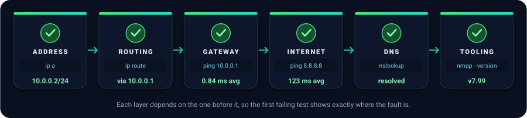
</p>

| # | Layer | Command | Result | What it proves |
| :-: | --- | --- | --- | --- |
| 1 | Address | `ip a` | `10.0.0.2/24` on `eth0` ✅ | The interface holds the intended address |
| 2 | Routing | `ip route` | `default via 10.0.0.1` ✅ | Traffic knows where to leave the subnet |
| 3 | Local network | `ping -c 3 10.0.0.1` | 3/3 replies, avg 0.84 ms ✅ | Kali reaches the lab gateway |
| 4 | Internet | `ping -c 3 8.8.8.8` | 3/3 replies, avg 123 ms ✅ | NAT works and outbound traffic flows |
| 5 | Name resolution | `nslookup networkwalks.com` | `192.232.216.135` via `8.8.8.8` ✅ | DNS is configured and working |
| 6 | Tooling | `nmap --version` | Nmap 7.99 ✅ | The scanning toolset is installed |

<p align="center">
  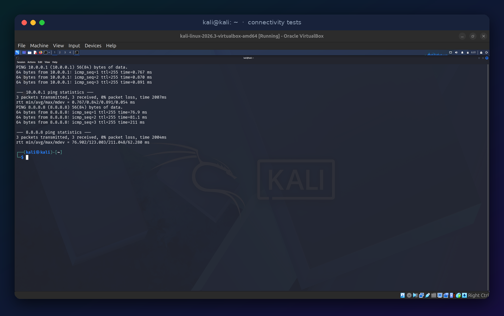<br>
  <sub><b>Figure 5.</b> Gateway and internet connectivity, 0% packet loss on both.</sub>
</p>

<p align="center">
  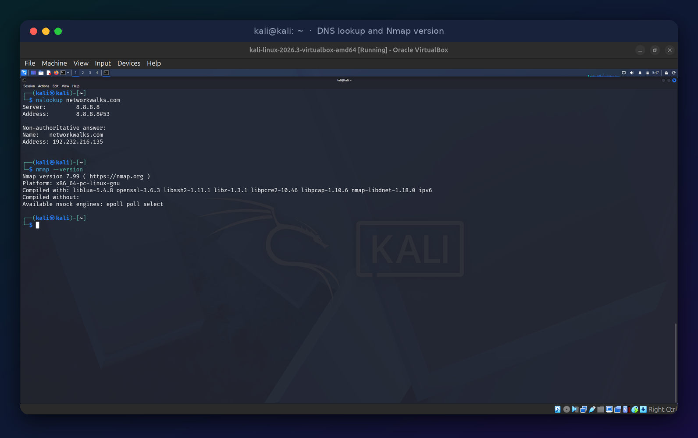<br>
  <sub><b>Figure 6.</b> DNS resolution and Nmap version check.</sub>
</p>

<br>

<h2><a name="problems"></a>Problems and fixes</h2>

<a name="problem-1"></a>

### 🐞 Problem 1: Kali had no IPv4 address

| | |
| --- | --- |
| **Symptom** | `eth0` was up but showed only an IPv6 link-local address (`fe80::...`). `ip route` printed nothing. |
| **Diagnosis** | No IPv4 address meant no DHCP lease. I checked the NAT Network (DHCP enabled, correct prefix) and the VM adapter (enabled, attached to `NatNetwork`, cable connected). |
| **Fix** | After a full shutdown and a fresh start of the VM, Kali received `10.0.0.4/24` from DHCP. |
| **Takeaway** | Adapter changes are applied reliably by powering the VM off and on, not by assuming a running VM picked them up. |

<p align="center">
  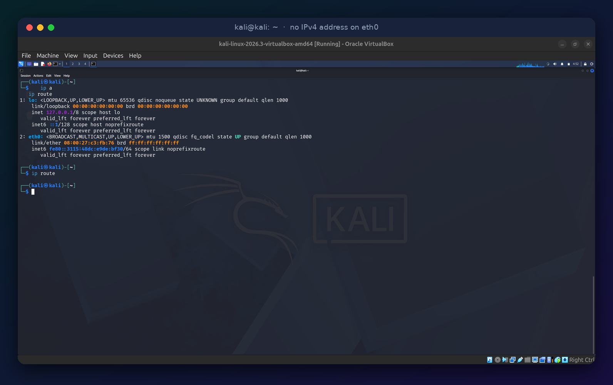<br>
  <sub><b>Figure 7.</b> Before the fix: no IPv4 address and an empty routing table.</sub>
</p>

<a name="problem-2"></a>

### 🐞 Problem 2: The static IP was not applied

| | |
| --- | --- |
| **Symptom** | After `nmcli connection modify`, `eth0` still had no IPv4 address. Pings to the gateway and to `8.8.8.8` failed with 100% packet loss, and `nslookup` could not reach a DNS server. |
| **Diagnosis** | The routes had been written (`proto static`), but the address itself was missing, so something stopped NetworkManager from activating it. The most likely cause is duplicate address detection (DAD), where NetworkManager checks whether another host already claims the address before keeping it. |
| **Fix** | Set the DAD timeout to zero and restart the connection (below). |
| **Result** | `10.0.0.2/24` came up, and the gateway, internet, and DNS tests all passed. |
| **Takeaway** | Static addressing can fail silently. The `ip a` output, not the absence of an error message, is the proof that a change worked. |

```bash
sudo nmcli connection modify "Wired connection 1" ipv4.dad-timeout 0
sudo nmcli connection down "Wired connection 1"
sudo nmcli connection up "Wired connection 1"
```

### 🧭 Quick troubleshooting guide

| Symptom | Likely cause | First thing to try |
| --- | --- | --- |
| No IPv4 address at all | Adapter not on the NAT Network, or VM not restarted | Check Adapter 1, then fully power the VM off and on |
| Address present, gateway ping fails | Wrong address or gateway | Compare `ip route` against the NAT Network prefix |
| Gateway works, `8.8.8.8` fails | NAT Network or host connectivity | Confirm the host itself has internet access |
| IP pings work, names do not resolve | DNS not set | Check `cat /etc/resolv.conf` and `ipv4.dns` |
| Static IP will not stick | Address check or wrong connection name | Run `nmcli connection show`, then set `ipv4.dad-timeout 0` |

<br>

<h2><a name="security"></a>Security notes</h2>

| | Practice | Why it matters |
| :-: | --- | --- |
| 🧱 | **Isolation** | The NAT Network is not reachable from my physical LAN by default. VMs reach the internet outbound, but nothing outside can initiate a connection to them unless port forwarding is configured. |
| 🚫 | **Never bridge vulnerable VMs** | Deliberately vulnerable targets belong only on the NAT Network. Bridging one would put it on a real network. |
| 👁️ | **Promiscuous mode: Deny** | Left at the default. Packet-capture experiments can enable it for a single VM when needed. |
| 🔑 | **Change default credentials** | The pre-built Kali image ships with well-known defaults. Change them before using the VM for anything serious. |
| ⚖️ | **Authorization first** | Techniques practised here apply only to systems I own or have explicit permission to test. |

<br>

<h2><a name="commands"></a>Command reference</h2>

<details>
<summary><b>🐉 Commands used on Kali</b></summary>

```bash
ip a                                      # show addresses
ip route                                  # show routing table and default gateway
nmcli connection show                     # find the connection name
nmcli device status                       # confirm the interface is connected

# Static IP configuration
sudo nmcli connection modify "Wired connection 1" \
  ipv4.method manual ipv4.addresses 10.0.0.2/24 \
  ipv4.gateway 10.0.0.1 ipv4.dns 8.8.8.8

# Fix for the address not applying
sudo nmcli connection modify "Wired connection 1" ipv4.dad-timeout 0
sudo nmcli connection down "Wired connection 1"
sudo nmcli connection up "Wired connection 1"

# Verification
ping -c 3 10.0.0.1
ping -c 3 8.8.8.8
nslookup networkwalks.com
nmap --version
```

</details>

<details>
<summary><b>🖥️ Commands used on the Ubuntu host</b></summary>

```bash
grep PRETTY_NAME /etc/os-release                      # host OS
uname -r                                              # kernel version
lscpu | grep "Model name"                             # CPU
free -h | grep Mem                                    # RAM
VBoxManage --version                                  # VirtualBox version
VBoxManage list vms                                   # list registered VMs
VBoxManage showvminfo "<vm-name>" | grep -E "Memory size|Number of CPUs|NIC 1"
```

</details>

<details>
<summary><b>⚙️ Optional: the same network setup from the command line</b></summary>

I used the VirtualBox GUI for this lab. These are the equivalent commands for anyone who prefers scripting it:

```bash
VBoxManage natnetwork add --netname NatNetwork --network "10.0.0.0/24" --enable --dhcp on
VBoxManage modifyvm "<vm-name>" --nic1 natnetwork --nat-network1 NatNetwork
```

</details>

<br>

<h2><a name="learned"></a>What I learned</h2>

| | Lesson |
| :-: | --- |
| 🧭 | **Network mode shapes the whole lab.** Choosing between NAT, NAT Network, Host-only, and Bridged is a security decision as much as a convenience one. |
| 🪜 | **Test in layers.** Checking address, route, gateway, internet, and DNS in order turned "the network is broken" into a specific, fixable fault, both times. |
| 🤫 | **A command that raises no error has not necessarily worked.** The static IP change looked successful and wasn't. Verifying the result is part of the job. |
| 🔍 | **Diagnosis beats guessing.** The routing table, interface state, and VM adapter settings each narrowed the problem before I changed anything. |
| 📝 | **Document failures, not just successes.** The two problems above are the most useful part of this write-up. |

<br>

<h2><a name="next"></a>Next steps</h2>

- [ ] Take a clean baseline snapshot of the configured Kali VM
- [ ] Verify the static IP survives a reboot
- [ ] Add a deliberately vulnerable target VM on the same NAT Network
- [ ] Run a host-discovery scan of the lab subnet only (`10.0.0.0/24`)
- [ ] Capture and analyse lab traffic with Wireshark

<br>

<h2><a name="layout"></a>Repository layout</h2>

```
.
├── README.md
├── 01-nat-network.png
├── 02-kali-vm-network.png
├── 03-no-ipv4-address.png
├── 04-dhcp-lease.png
├── 05-static-ip.png
├── 06-connectivity-ping.png
├── 07-dns-nmap.png
├── architecture.svg
├── banner.svg
├── connect.svg
├── glance.svg
└── verification-flow.svg
```

<br>

<h2><a name="connect"></a>Connect</h2>

<p align="center">
  <a href="https://www.linkedin.com/in/karibwende-blair-088012287">
    
  </a>
</p>

<p align="center">
  <sub>Tools used: <a href="https://www.virtualbox.org/wiki/Downloads">VirtualBox</a> · <a href="https://www.kali.org/get-kali/">Kali Linux</a> · <a href="https://nmap.org/">Nmap</a></sub>
</p>
